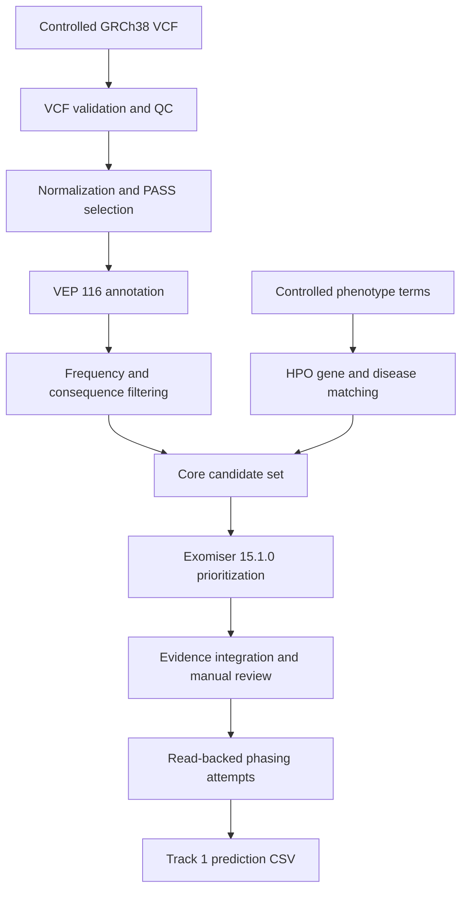

# Track 1 analysis workflow

## Scope

This workflow prioritizes candidate small variants from a single-sample
GRCh38 whole-genome VCF using variant annotation, population frequency,
predicted molecular consequence, phenotype associations and Exomiser
phenotype-driven prioritization.

The submitted prediction represents a candidate compound-heterozygous
hypothesis. Read-backed phasing was attempted, but the cis/trans relationship
could not be resolved with the available short-read data.

## Data governance

The analysis used controlled genomic and phenotype data. These inputs are not
distributed in this repository.

Excluded controlled files include:

- FASTQ and BAM files;
- original and annotated VCF files;
- individual-level phenotype documents;
- HPO term lists and phenopackets;
- variant-level private review tables;
- sample identifiers;
- reference databases and software caches.

Only the final challenge CSV, an analysis report, workflow code and aggregate
non-identifying summaries are provided.

## Workflow overview

## 1. Input validation and QC

The starting VCF contained 5,012,204 records and one sample.

Validation included:

- compressed VCF and index accessibility;
- random-access region queries;
- sample-count verification;
- contig inspection;
- GRCh38 reference-allele checking;
- genotype, depth and genotype-quality summaries;
- separation of primary chromosomes from auxiliary contigs.

No reference-allele mismatches were detected in the audited primary variants.

## 2. Variant normalization

Primary-contig variants were normalized against the Ensembl GRCh38 reference.

The normalized primary VCF contained 4,962,046 records. Multiallelic records
were split and symbolic alleles were excluded from the small-variant analysis.

A total of 4,727,733 normalized PASS records were retained for annotation.

## 3. Functional annotation

Variants were annotated offline using:

- Ensembl VEP 116.1;
- Homo sapiens cache version 116;
- GRCh38 assembly;
- Ensembl GRCh38 reference FASTA.

The annotation included molecular consequence, impact, gene and transcript
identifiers, HGVS descriptions, MANE information, SIFT, PolyPhen, ClinVar and
gnomAD population-frequency fields.

## 4. Candidate extraction

Candidate tiers combined clinical annotation, molecular consequence,
population frequency and in-silico evidence.

The initial extraction produced 367 candidate rows representing 281 unique
gene symbols.

Candidate classes included:

- ClinVar pathogenic or likely pathogenic variants;
- variants with mixed or conflicting ClinVar interpretations;
- rare HIGH-impact variants;
- rare damaging MODERATE-impact variants;
- rare splice-related variants.

Aggregate counts are available in the `supporting/` directory.

## 5. Phenotype integration

Five case phenotype terms were used for primary phenotype prioritization.
Personal and family-history terms were retained as contextual evidence and
were not treated as equivalent to findings observed in the proband.

Phenotype-to-gene and phenotype-to-disease associations were evaluated using:

- Human Phenotype Ontology release 2026-06-23;
- `phenotype_to_genes.txt`;
- disease-level coherence of exact HPO matches.

This stage identified:

- 92 candidate rows with a direct case phenotype-to-gene match;
- 72 unique directly matched genes;
- 25 central candidates supported by at least two exact phenotype terms within
  a coherent gene–disease model;
- 21 unique genes among the central candidates.

Individual HPO terms are omitted from this public repository.

## 6. Exomiser analysis

Phenotype-driven prioritization was performed with:

- Exomiser CLI 15.1.0;
- phenotype database release 2602;
- GRCh38 genome database release 2602;
- confirmed proband sex in the phenopacket.

The genome-wide PASS analysis processed 4,727,733 VCF records and retained 589
filtered variants in 364 genes.

The resulting tables contained:

- 421 ranked gene rows;
- 794 ranked variant rows;
- 7 exact overlaps with the phenotype-derived central candidate set.

A targeted FULL-mode diagnostic analysis was subsequently used to inspect all
25 central candidates and record the filters responsible for excluding
variants from the genome-wide PASS-only ranking.

## 7. Evidence integration

The 25 central candidates were classified according to:

- Exomiser contribution;
- phenotype coherence;
- clinical annotation;
- population frequency;
- predicted consequence;
- transcript support;
- genotype quality;
- inheritance compatibility;
- Exomiser failed-filter information.

The final priority bands were:

| Priority band | Candidates |
|---|---:|
| P1 primary review | 3 |
| P2 other Exomiser contributors | 4 |
| P3 annotation rescue | 8 |
| P4 technical validation | 1 |
| P5 inheritance review | 5 |
| P6 frequency review | 4 |

The submitted pair was selected from the P1 primary-review group.

## 8. Read-backed phasing

The two submitted variants occur in the same gene and were evaluated as a
potential autosomal-recessive pair.

Read-backed phasing was attempted with:

- WhatsHap 2.8;
- HapCUT2;
- an indexed regional BAM;
- a regional heterozygous VCF;
- the corresponding GRCh38 chromosome reference.

Both variants were present and heterozygous. However:

- neither candidate received a shared phase set;
- no sequencing template directly bridged both sites;
- WhatsHap did not resolve the pair;
- HapCUT2 did not resolve the pair.

The available short-read evidence therefore does not establish whether the
variants are in cis or in trans.

## 9. Final submission

The Track 1 CSV contains one ranked primary hypothesis with two GRCh38
variants. The EPCR value is a ranking confidence assigned for the challenge
submission and is not a clinically calibrated probability.

The result should be interpreted as a research prioritization hypothesis,
not as a clinical diagnosis.

## Reproducibility boundaries

The repository enables review of:

- software versions;
- filtering logic;
- aggregate intermediate results;
- prioritization methodology;
- construction of the final submission CSV.

Exact end-to-end reproduction requires authorized access to the controlled
VCF, BAM and phenotype inputs, which are not publicly distributed.
